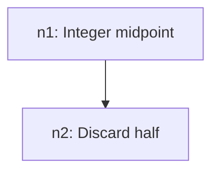

# VFX Fixture: Binary search — lesson plan

SYNTHETIC FIXTURE for verify-vault.

## Where the learner starts

Indexing is solid. The edge is integer mid on odd-length ranges.

## Goal and final checks

1. Trace lo/hi/mid to a found index (final check after n2).
2. Explain why sortedness is required (final check after n2).

## Dependency graph

## Nodes

| Id | Node | Rests on (unconditional truth) | Discovery question | Check type | Can do | Est. min | Prereqs | Status |
| --- | --- | --- | --- | --- | --- | --- | --- | --- |
| n1 | Integer midpoint | mid = (lo + hi) // 2 always lands inside [lo, hi] | Where is the middle of indexes 0 to 7? | free response | Compute mid for any lo, hi | 10 | | checked |
| n2 | Discard half | In a sorted array, a[mid] < target means every index <= mid is too small | If a[3] is too small, which indexes can we ignore? | free response | Say which half to drop and why | 15 | n1 | planned |

## Session groups

- Session 1: n1
- Session 2: n2

## Review notes

Fixture plan; not fact-checked.
