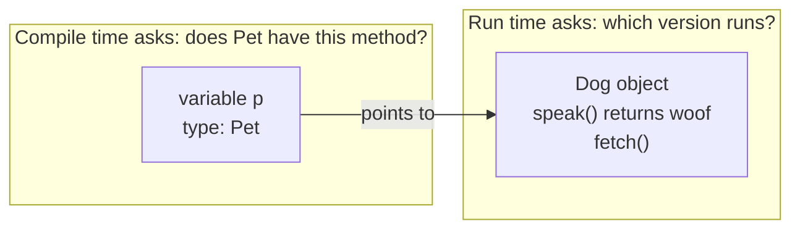
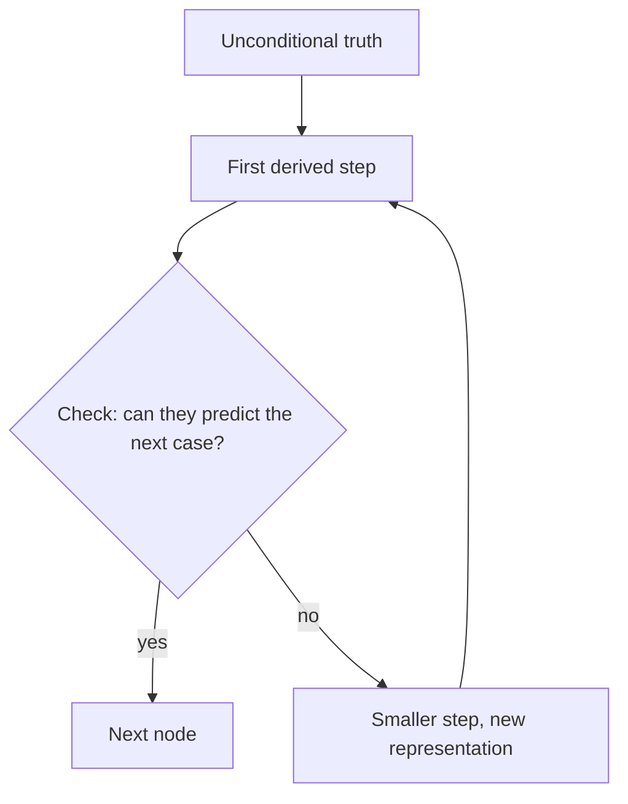

# Diagrams — rules for pictures in lessons and plans

Obsidian renders mermaid blocks, LaTeX, and embedded SVG files natively, so a diagram written into a note is a diagram the learner sees. Mermaid draws structure: steps, decisions, dependencies. An SVG figure draws math: curves, vectors, angles, regions, surfaces. A diagram earns its place when the *shape* of an idea is the point: a dependency order, a decision, a flow, a two-axis tradeoff. It does not earn its place as decoration. A diagram makes a plan inspectable; it does not make it correct, so it never replaces a check question.

## When to draw which

| The idea is about… | Draw | Mermaid type |
| --- | --- | --- |
| What depends on what (the plan itself, prerequisite chains) | Dependency graph | `flowchart TD` |
| A process or algorithm's steps | Flow chart | `flowchart TD` or `LR` |
| A choice with conditions ("if X then…") | Decision tree | `flowchart TD` with `{diamond}` nodes |
| Two independent tradeoffs | Quadrant chart | `quadrantChart` |
| Objects and their relationships (classes, tables, entities) | Class diagram | `classDiagram` |
| Order of events between parties | Sequence diagram | `sequenceDiagram` |
| A state that changes on events | State diagram | `stateDiagram-v2` |
| A math picture: curves, level curves, vectors, angles, regions, a surface | SVG figure | none; see *Math pictures as SVG figures* |

If a type fails to render in Obsidian (its bundled mermaid can lag the newest release), fall back to `flowchart`, which always renders.

## Rules that keep diagrams rendering

- Fence with three backticks and `mermaid`, nothing else on the fence line.
- Twelve nodes or fewer. If it needs more, it is two diagrams.
- Node ids: letters and digits only (`n1`, `Base`, `Step2`). Put the human text in the label.
- Quote any label containing parentheses, colons, quotes, or `#`: `A["f(x): the input"]`. Unquoted, these characters break the parser.
- Edge labels: `A -- "label" --> B` or `A -->|"label"| B`.
- No `%%{init}` directives, no `click` handlers, no HTML in labels except `<br/>` for a line break. One level of `subgraph` at most.
- No `classDef` or `style` lines. The vault's CSS colours every diagram to match the log and flips it for dark mode; an inline colour overrides both.
- Re-read the block after writing it: balanced brackets and quotes, every id defined before it is styled, arrows pointing the way the reasoning flows.

## Diagrams in chat replies

When a reply teaches something with a shape, draw it as a mermaid block or an SVG figure in the reply, never as box-drawing characters or arrows typed out as text. The reply is mirrored into the subject's `log.md`, where the learner reads along and Obsidian draws it in the log's style. The terminal shows only the mermaid source (2026-10-13).

- Mark the one node the reply is about with `class <id> key` on its own line. The log's CSS draws every other node as translucent glass and this one solid with an ink outline. One per diagram, two at most, or nothing stands out.
- Keep decision (`{diamond}`) labels to about four words. A diamond grows with its label, and a long one swamps the diagram.
- Side-by-side comparisons (compile time vs run time, before vs after) read best as `flowchart LR` with one `subgraph` per side. Chains of decisions read best as `TD`.
- Two cases keep box-drawing characters in a ` ```text ` block. Any picture inside a question-picker probe, because the picker shows mermaid as raw source. And grids that must line up cell by cell (array slots, a memory layout next to the code), because mermaid cannot align cells.



## Math pictures as SVG figures

Edison picked SVG figures over text sketches on 2026-10-23. A text sketch of a geometric idea (an arrow made of `↑` and `|`, a contour made of dashes) reads as crude and hides the angle or shape it is about.

- **File.** Write the figure to `learn/subjects/<slug>/figures/<slug>-<topic>.svg`, starting from `learn/system/templates/figure.svg`. Name it by topic, never by node number: `lagrange-multipliers-14-8-gradient-perpendicular.svg`. Obsidian finds an embed by file name across the whole vault, so the subject slug keeps names unique.
- **Embed.** Put `![[<file name>.svg]]` on its own line in the reply and in the session note's `**Diagram.**` line. The terminal shows that one line, and the subject's `log.md` shows the picture. Reuse a figure that already exists before drawing a new one.
- **Check.** Run `xmllint --noout <file>` after writing. A malformed SVG renders as a broken image.
- **Geometry.** Compute coordinates from the math instead of placing them by eye. Take each point from the curve's formula, check a right angle with a dot product, and write the formula in an XML comment next to the shape it draws. SVG's y-axis points down, so flip the sign of y.
- **Ink only.** Figures follow the `vault-design` skill's color jobs, so they use no green, gold, ember, indigo, or subject color: each of those already means something in the record. Edison chose ink only on 2026-10-23. Emphasis comes from weight and shade. The one thing the reply is about is `key`: Ink, stroke 3, with a bold label. The object it sits on is `main`: Ink 2, stroke 2. Everything else is `other`: Ink 3, stroke 1.5. A wrong or rejected option is `rejected`: Ink 3, dashed, with an Ink 3 label. Draw with the template's classes, never a raw color, so night mode works.
- **Night.** The template's `prefers-color-scheme: dark` block swaps each class to its night token. All six ink colors pass 4.5:1 on their paper, light and night, checked with the brand-guideline skill's `contrast.py` on 2026-10-23.
- **Shape and text.** Set a stroke width that differs from the class with `style="stroke-width:2.5"`, because a class beats a plain `stroke-width` attribute. Arrowheads come from the template's markers, one per class. Labels are 14 to 17 px, set beside the thing they name. One caption line at the bottom states the idea in words. At most about six labels.
- **Size.** `viewBox="0 0 760 470"`, the template's default, or narrower. Keep every label inside the box.
- **Not in probes.** A question-picker probe cannot show an image, so a figure a probe depends on stays a text sketch inside the question, as above.

## Math

Inline math `$x^2$`, display math on its own lines with `$$ … $$`. Obsidian uses MathJax; standard LaTeX commands work, `\text{}` for words inside math.

## Code

Fenced code blocks with a language tag (` ```java `, ` ```python `). Keep example code under 20 lines; a check question about a 40-line example is a reading test, not a concept test.

Lay code out the way the learner's editor does: 4-space indents, one statement per line, and a method or `if` body on lines of its own, never `void speak() { ... }` on one line. The learner copies examples into the Code runner and their IDE, and 2-space one-liners read as wrong there (2026-10-13).

## A minimal example


