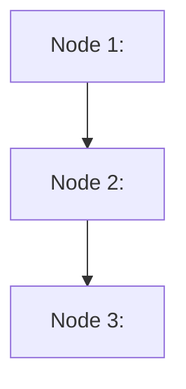

# {{Title}} — lesson plan

## Where the learner starts

*(Two or three lines from the diagnosis: which strands are strong, where the edge is, what is skipped.)*

## Goal and final checks

*(Restate the success criteria from `record.md`; each maps to a final check at the end of the plan.)*

## Chains

*(One line per final check: the nodes it runs through in order, then what each step does. `n2 → n3 → n5`: find the candidates, solve by cases, compare values. A node on no chain and not a prerequisite of a chain node is not core.)*

## Dependency graph

## Nodes

*(In teaching order. Each node is one concept, teachable in one sitting of 10–20 minutes. Prereqs reference node ids, or `<slug>/nN` for a node in another subject.)*

| Id | Node | Rests on (unconditional truth) | Discovery question | Check type | Can do | Est. min | Prereqs | Status |
| --- | --- | --- | --- | --- | --- | --- | --- | --- |
| n1 |  |  |  |  |  |  |  | planned |
| n2 |  |  |  |  |  |  |  | planned |

## Session groups

*(Nodes grouped into 45–60 minute sessions. Re-group at `/learn-end` if pace differs from the estimate.)*

### Core

*(The nodes the chains need. Their estimated minutes fit `budget:` in `record.md` when it is set.)*

- Session 1: n1, n2
- Session 2: n3, …

### If time

*(Everything else, taught only after the core is `checked`. Each cut forced by the budget is listed under Review notes with the final check it weakens.)*

## Review notes

*(What `fact-checker` and `plan-reviewer` flagged, and what was changed. Unresolved uncertainty stays listed here until resolved.)*
